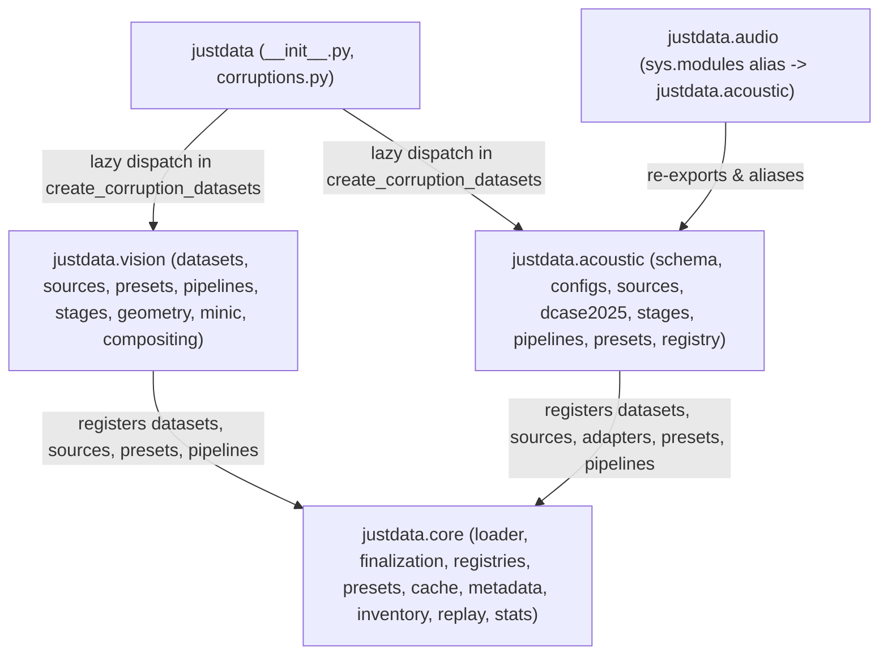

# `justdata` Blueprint

## System Overview

`justdata` (`src/justdata`) is a TensorFlow-native data pipeline package organized around a schema-neutral execution
core (`justdata.core`) and explicit modality packages (`justdata.vision`, `justdata.acoustic`, and compatibility alias
`justdata.audio`). Importing `justdata` itself exposes only package version metadata without importing modality stacks;
importing `justdata.vision` or `justdata.acoustic` registers modality-specific datasets, source loaders, adapters,
presets, and `(preprocess_fn, augment_fn, late_augment_fn, postprocess_fn)` pipelines into `justdata.core`'s
lock-protected registries.

## Local Interface & Invariants

- **Interface**:
  - `[__init__.py:__version__]`: Package version string constant (`"1.7.0"`), the sole symbol exported in
    `[__init__.py:__all__]`.
  - `[corruptions.py:create_corruption_datasets]`: Cross-modal corruption dataset factory
    `(modality: Literal["vision", "acoustic"], corruption_types: list[str], severity: int, base_dataset: str, preset: str | None, *, split: str = "validation", seed: int = 0, **load_kwargs)`
    exported in `[corruptions.py:__all__]`, dispatching to `justdata.vision.minic.create_minic_datasets` or
    `justdata.acoustic.corruptions.create_audio_corruption_datasets`.
  - `[py.typed:py.typed]`: Empty PEP 561 marker declaring inline static type annotations across `justdata`.
- **Local Invariants**:
  - `[__init__.py:__all__]`: Top-level `justdata` exports only `["__version__"]` and does not eagerly import `core`,
    `vision`, `acoustic`, `audio`, or `corruptions`.
  - `[corruptions.py:create_corruption_datasets]`: Requires `modality in ("vision", "acoustic")` (`ValueError`
    otherwise); when `modality == "vision"`, populates `load_kwargs` defaults via `setdefault`
    (`dataset_names_arg=base_dataset`, `splits_arg=split`, `dataset_type="train" if split == "train" else "validation"`,
    `seed=seed`) and resolves `pipeline` via `justdata.core.registry.get_pipeline(dataset=base_dataset, preset=preset)`
    only when neither `"pipeline"` nor `"postprocess_fn"` is already in `load_kwargs`; when `modality == "acoustic"`,
    forwards directly to `justdata.acoustic.corruptions.create_audio_corruption_datasets`.
- **Local Side Effects**:
  - `[corruptions.py:create_corruption_datasets]`: Lazily executes `import justdata.vision` (when
    `modality == "vision"`) or `import justdata.acoustic` (when `modality == "acoustic"`), triggering the target
    modality's global registry mutations.

## Subdirectories & System Boundaries

- `core`: [`./core/EGM.md`](./core/EGM.md) - Modality-neutral execution engine providing thread-safe dataset, source,
  adapter, pipeline, and preset registries; canonical `tf.data` loading (`fetch_ds`, `load_ds`) and batch finalization
  (`finalize_dataset`); deterministic `ExecutedConfig` snapshots; quota-enforced TFRecord caching (`CachePolicy`);
  detached JSONL metadata sidecars (`MetadataSidecar`); SHA-256-verified offline inventories (`admit_inventory`);
  cursor-resumable epoch replay (`load_replay_epoch`); and float64 Chan/Welford feature statistics
  (`compute_feature_stats`).
- `vision`: [`./vision/EGM.md`](./vision/EGM.md) - Computer vision modality package registering vision datasets,
  `hf:`/`zenodo:`/`wilds:` source loaders, `modality="vision"` presets, and classification/segmentation/panoptic
  pipelines, alongside recorded-geometry replay/restoration, evaluation views, Mini-C dataset creation, and colorspace,
  filtering, Poisson cloning, and eager scene compositing primitives. Child component contracts:
  [`./vision/augmentations/EGM.md`](./vision/augmentations/EGM.md),
  [`./vision/corruptions/EGM.md`](./vision/corruptions/EGM.md),
  [`./vision/encodings/EGM.md`](./vision/encodings/EGM.md), and [`./vision/tasks/EGM.md`](./vision/tasks/EGM.md).
- `acoustic`: [`./acoustic/EGM.md`](./acoustic/EGM.md) - TensorFlow-native acoustic modality package unifying canonical
  `AudioSample` adaptation, WAV/`local_audio:`/`hf_audio:`/`dcase2025:` sources, DCASE 2025 Task 1 split-leakage guards,
  resampling, channel/segment/eval-view stages, feature normalizers, serializable `AudioPreset` configs, thread-safe
  registries, metadata encoding, JAX/NumPy helpers, and registered `acoustic/*` pipelines. Child component contracts:
  [`./acoustic/augment/EGM.md`](./acoustic/augment/EGM.md), [`./acoustic/compat/EGM.md`](./acoustic/compat/EGM.md),
  [`./acoustic/corruptions/EGM.md`](./acoustic/corruptions/EGM.md), and
  [`./acoustic/frontends/EGM.md`](./acoustic/frontends/EGM.md).
- `audio`: [`./audio/EGM.md`](./audio/EGM.md) - Compatibility alias package re-exporting `justdata.acoustic.__all__` and
  aliasing `justdata.audio.*` to canonical `justdata.acoustic.*` `ModuleType` instances in `sys.modules`.

## Global Invariants

- **Core Modality Neutrality & Explicit Registration**: `justdata.core` never imports `justdata.vision` or
  `justdata.acoustic` and never inspects modality-specific sample keys (`[core/loader.py:_prepare_ds]`,
  `[core/finalization.py:_pad_nested]`); callers must import `justdata.vision` or `justdata.acoustic` (or
  `justdata.audio`) before resolving built-in modality datasets, presets, or pipelines (`[vision/__init__.py:__all__]`,
  `[acoustic/__init__.py:__all__]`, `[audio/__init__.py:_acoustic]`).
- **Canonical 4-Stage Pipeline & `tf.data` Execution Order**: Every registered `DataPipeline` builds
  `(preprocess_fn, augment_fn, late_augment_fn, postprocess_fn)` (`[core/registry.py:DataPipeline]`), and `core`
  executes stages in fixed order
  `('fetch_ds', 'adapter', 'preprocess', 'cache', 'augment', 'shuffle', 'postprocess', 'batch', 'late_augment', 'pad', 'prefetch')`
  (`[core/loader.py:_STAGE_ORDER]`), attaching boolean `padding_mask` of shape `(batch_size,)` to every finalized batch
  (`[core/finalization.py:_pad_dataset]`).
- **RNG Stage Isolation & Stateless Seeded Transforms**: Per-sample `augment` and batch-level `late_augment` use
  separate `tf.random.Generator` instances in `load_ds`/`finalize_dataset` (forcing `num_parallel_calls=1` when
  `deterministic=True`) and indexed stateless seeds in `finalize_epoch` (`[core/loader.py:_prepare_ds]`,
  `[core/loader.py:finalize_epoch]`, `[core/finalization.py:_seed_for_index]`), while all vision and acoustic stochastic
  augmentations and corruptions derive draws purely from explicit stateless `seed` tensors
  (`[vision/augmentations/auto.py:rand_augment]`, `[vision/corruptions/registry.py:draw_seed]`,
  `[acoustic/_random.py:_seed_tensor]`, `[acoustic/corruptions/registry.py:_seed_from_index]`).
- **Thread-Safe Registries & Canonical Config/Preset Hashing**: All core, vision, and acoustic registries guard writes
  with `threading.Lock` and raise `ValueError` on duplicate registration (`[core/registry.py:register_dataset]`,
  `[core/presets.py:register_preset]`, `[vision/augmentations/registry.py:register_crop_strategy]`,
  `[vision/corruptions/registry.py:register_corruption]`, `[acoustic/registry.py:_register]`); `ExecutedConfig`
  serializes UTF-8 sorted-key compact JSON with `allow_nan=False` (`[core/executed_config.py:canonical_config_json]`),
  while `canonical_preset_json` and `acoustic.configs._SerializableConfig` serialize sorted-key compact JSON hashed to
  16-hex SHA-256 digests (`[core/presets.py:preset_hash]`, `[acoustic/configs.py:_SerializableConfig]`).
- **Cross-Modal Metadata, Sidecar & Untrusted-Input Safety**: `metadata_mode` (`"full"`, `"numeric_only"`, `"none"`),
  63-bit `stable_int64_hash`, and fingerprint-verified JSONL sidecars (`MetadataSidecar`) behave uniformly across
  modalities (`[core/metadata.py:apply_metadata_mode]`, `[core/metadata.py:verify_sidecar_keys]`,
  `[acoustic/metadata.py:MetadataEncoder.encode]`); external archives, manifests, and offline inventories enforce strict
  URL/column checks, checksum verification, extraction/size budgets, and atomic file replacement
  (`[vision/sources.py:_validate_zenodo_download_url]`, `[vision/sources.py:_extract_archive]`,
  `[acoustic/sources.py:load_local_audio_manifest_splits]`, `[acoustic/dcase2025.py:assert_stats_allowed]`,
  `[core/inventory.py:admit_inventory]`).

## Global Side Effects

- **In-Memory Global Registry & `sys.modules` Mutations**: Importing `justdata.core.sources` registers the default TFDS
  source loader (`[core/sources.py:load_tfds_splits]`); importing `justdata.vision` or `justdata.acoustic` populates
  process-wide dataset, source, adapter, preset, pipeline, augmentation, frontend, and corruption registries under
  module locks (`[vision/__init__.py:__all__]`, `[acoustic/__init__.py:__all__]`); importing `justdata.audio` aliases
  `justdata.audio.*` entries in `sys.modules` (`[audio/__init__.py:_alias_name]`).
- **TensorFlow Runtime & Stateful Generator Allocation**: `configure_tensorflow_cpu` mutates process-global TensorFlow
  GPU visibility and thread pools (`[core/execution.py:configure_tensorflow_cpu]`); `_prepare_ds` allocates and advances
  stateful `tf.random.Generator` variables when running non-epoch pipelines (`[core/loader.py:_prepare_ds]`), and
  `finalize_dataset` advances a caller-supplied `rng` via `rng.make_seeds(1)`
  (`[core/finalization.py:finalize_dataset]`).
- **External Dataset Network I/O, Locked Caching & Atomic Snapshot Writes**: Source loaders and cache/inventory/sidecar
  facilities read local manifests/media, download external datasets (TFDS, Hugging Face `datasets`, Zenodo HTTPS, WILDS)
  into `~/.cache/justdata` or caller `data_dir` under `filelock`/directory locks, write TFRecord cache/inventory files,
  and atomically replace staged Zenodo archives/extractions, cache and inventory `manifest.json` files
  (`manifest.pending` -> `manifest.json`), and JSONL metadata sidecars (`[core/sources.py:source_cache_dir]`,
  `[core/cache.py:protected_cache]`, `[core/metadata.py:MetadataSidecar.write_jsonl]`,
  `[core/inventory.py:admit_inventory]`, `[vision/sources.py:_prepare_zenodo_archive]`,
  `[acoustic/sources.py:load_huggingface_audio_splits]`).

## System Verification

- Run: `uv run pytest`
- Run: `sh tests/doctor/test_lint.sh`
